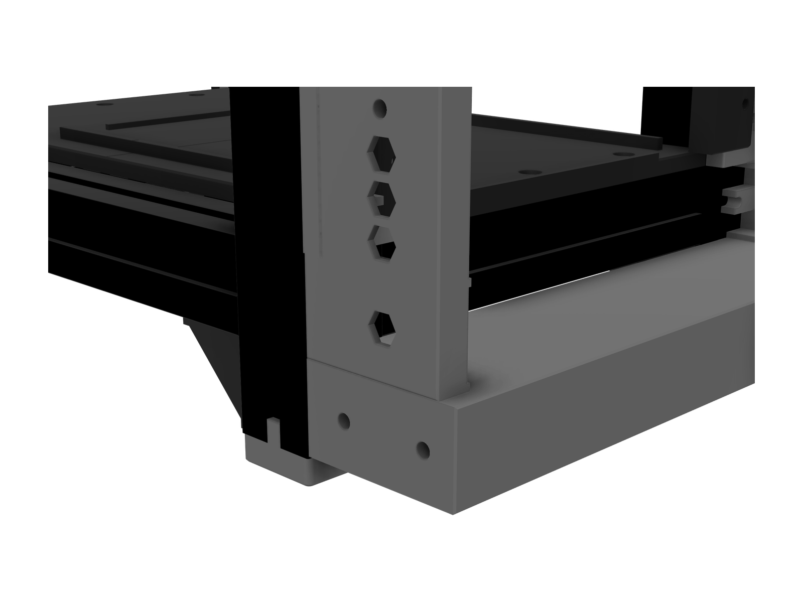
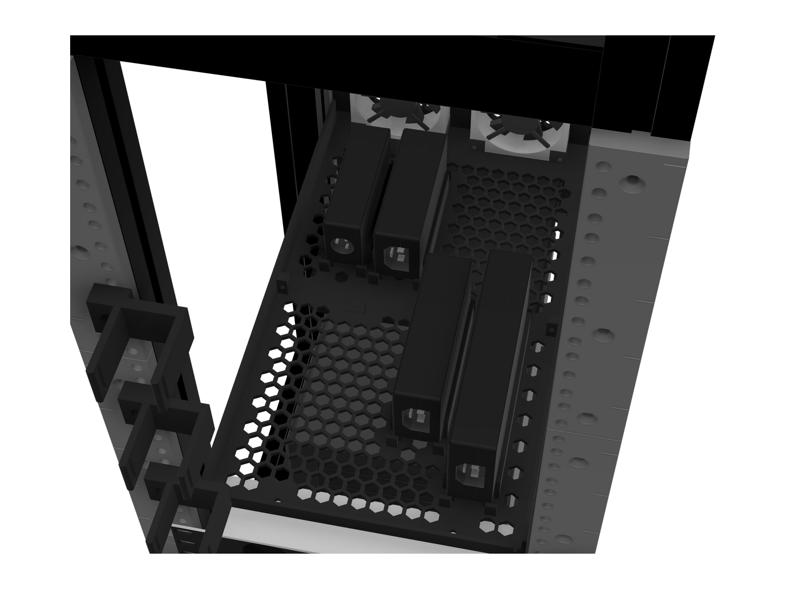
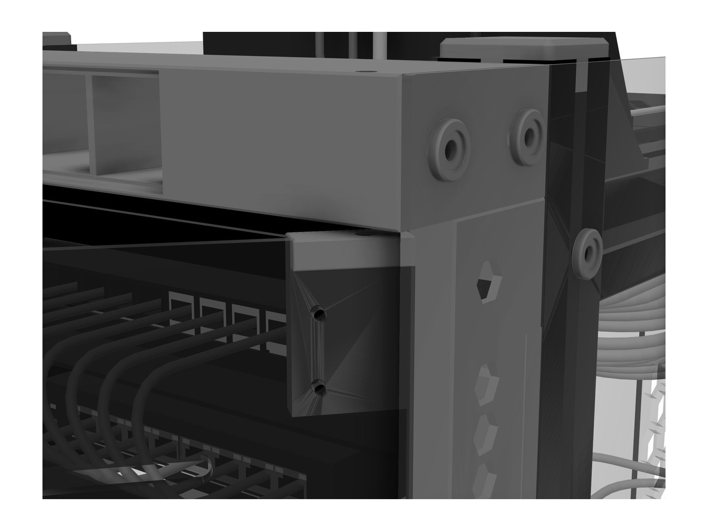
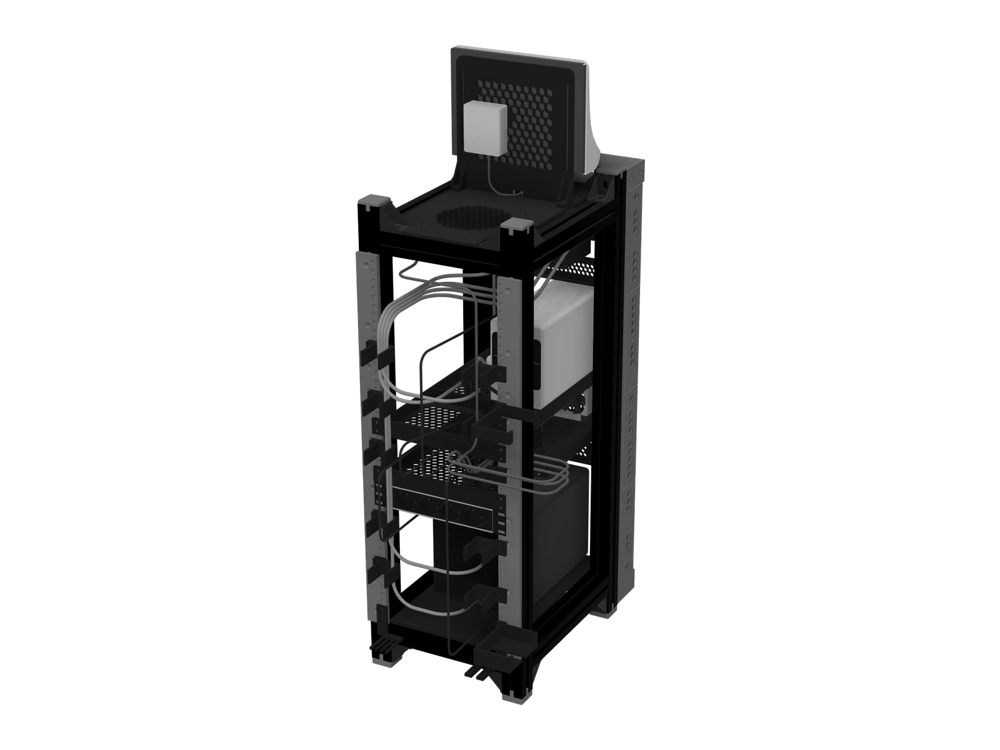
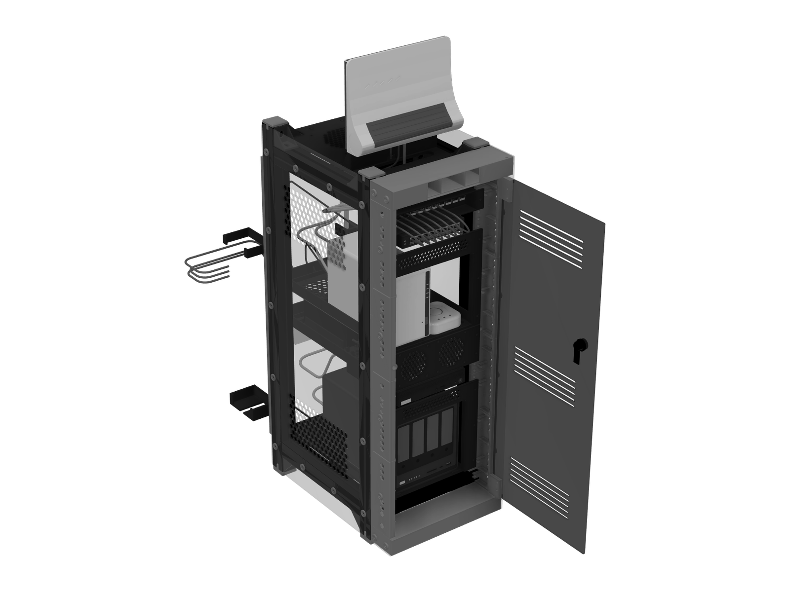

## Il problema

Gli apparecchi di rete di casa (due NAS, un mini PC, uno switch, il router, un
bridge per le luci, il terminale della fibra) vanno in un rack da 10 pollici
chiuso da lastre e porta, ventilato, con il fianco destro e il retro contro il
muro.

## I vincoli

- **Il profilo che avevo.** Quattro barre di profilo 4040 da 400 mm, che ho
  misurato: cava da 8, labbro 3,5, foro centrale 6,5. Sono diventate i quattro
  longheroni da 300.
- **Lo standard.** Guide da 10 pollici con i fori a 236,5 mm, unità da 44,45 mm:
  15 unità utili.
- **Il muro.** Sta a destra e dietro. La porta non deve sporgere dalla sagoma
  del rack, né chiusa né aprendosi, e deve aprirsi con il fianco destro
  appoggiato al muro.
- **La sicura.** La porta non deve aprirsi tirandola: ci vuole una chiave.
- **Il piatto.** Ogni parte deve entrare nel piatto della stampante, senza
  sbalzi critici.

## Il progetto

Il progetto è mio, fatto con Claude: misure e scelte sono mie, la geometria e i
controlli sono script Python per Autodesk Fusion scritti con Claude. Ogni quota
sta in un solo file di parametri, e cambiare una misura vuol dire rigenerare le
parti.

Il telaio misura 302 x 380 x 840 mm: 4 montanti da 840, 6 traverse da 222, 4
longheroni da 300 e 20 squadrette. Sui montanti ci sono le guide stampate, con
gli inserti M5 a caldo. Dal basso: il NAS a 4 dischi in una cornice da 5 unità,
il mini PC, una mensola con gli alimentatori e due ventole da 80, il secondo NAS
con il bridge in un'altra cornice da 5 unità, lo switch, il patch panel. Il
router sta sopra, appeso a una parete stampata; sul retro della stessa parete è
appeso il terminale della fibra. Una ventola da 140 estrae l'aria da sotto la
piastra superiore. Le sagome degli apparecchi nel modello sono prese dalle foto
ufficiali: forme, prese e LED.

I fianchi sono due lastre di acrilico fumé da 3 mm, 454 x 838, uguali: stesso
DXF, la sinistra si monta capovolta.

La mensola degli alimentatori è fatta di due vassoi stampati, uniti da tre code
di rondine nel fondo e da una vite M4 per fianco. I quattro alimentatori stanno
in piedi sul fianco, sfalsati: davanti a una delle due ventole, nei primi 90 mm,
non c'è nessun alimentatore.

Il patch panel è un pezzo mio: 12 posti keystone su una lastra incassata di
35,5 mm dietro il fronte, in una vaschetta fra i montanti. Così i cavetti
verso lo switch stanno dietro la porta chiusa, a 5 mm.

## La porta

La porta è una lastra di acrilico fumé da 4 mm, 297 x 755, con 15 feritoie in
tre gruppi. Sta incassata fra i fianchi, a filo con il loro bordo, con 2,5 mm di
luce attorno: sopra un cappello e sotto uno zoccolo stampati, larghi come il
rack. Niente cerniere in vista e niente maniglia.

I perni sono due grani M5 senza testa, a destra, sull'asse a 12 mm dentro il
bordo: quello di sotto è avvitato nello zoccolo, quello di sopra scende dal
cappello e si gira con la chiave dall'alto. Entrano in due blocchetti stampati,
fissati dietro la lastra con quattro viti M3 svasate. Per togliere la porta si
svita il grano di sopra di 6 mm, si inclina la porta in avanti e si sfila dal
perno di sotto.

Si apre a pressione: un fermo magnetico da incasso nella colonna sinistra, con
4 mm di luce dalla lastra, la spinge fuori. Una serratura a camma con chiave,
nella lastra, chiude la camma dietro la parete della colonna sinistra: la sua
flangia, che sporge circa 3 mm, è l'unica cosa fuori dal filo.

Con il muro a destra e dietro, la porta aperta resta dentro la sagoma del rack:
con il fianco contro il muro arriva a 92 gradi, e la prima cosa a toccare è la
flangia della serratura.

Nel cappello c'è la finestra per una targa con il QR della rete ospiti, a
intarsio bianco e nero, che entra a pressione. Nei render la targa non compare.

## I cavi

Nel modello ci sono anche i 41 cavi, ognuno con il suo diametro e il suo raggio
minimo di curvatura: 35,36 m in tutto, fra rete, fibra, corrente, alimentatori e
USB. Dietro, sulle guide posteriori, dieci anelli e due pettini li tengono in
due canali: rete a destra, corrente a sinistra.

## Cosa è verificato, e cosa no

Sul modello: 260 corpi nel controllo delle interferenze, nessuna non voluta
(l'unica trovata sono le costole che tengono la targa a pressione, ed è voluta).
La porta aperta da 5 a 90 gradi: nessun urto. I 41 cavi: nessun contatto fra
cavo e cavo, 5,0 mm dalla porta chiusa. Le parti stampate sono 43 pezzi
distinti più 4 provini: 111 stampe, circa 2,8 kg di PETG stimati, e tutte
entrano nel piatto.

Non è ancora stampato né montato. Il primo pezzo da stampare è un provino di
tolleranza: da quello si fissano il foro degli inserti, il gioco delle viti M5 e
la linguetta che entra nella cava del profilo. Due cose il modello non le
dimostra: il fermo va comprato e provato su un provino prima di stampare le
quattro colonne sinistre; la serratura va misurata prima di ordinare il taglio
laser della porta, perché il foro nella lastra lo fa il laser e non si rifà.
Anche i cavetti del patch panel vanno misurati, e il provino a tre sedi
stampato, prima del pannello.

## Supporti di altri autori

Nei vani del mini PC e dello switch vanno due supporti pubblicati da altri
autori, e per questo nei render non compaiono:

- mini PC: [Lenovo ThinkCentre Tiny 10" Rack Mount](https://makerworld.com/it/models/1945283-lenovo-thinkcentre-tiny-10-rack-mount-m720q)
  di Tim (@Timmi101), MakerWorld, CC BY-SA 4.0;
- switch: [10" Rack Mount 1U Netgear GS308EPP](https://www.printables.com/model/1369319-10-rack-mount-1u-netgear-gs308epp)
  di Pablo (@pablo_1344153), Printables, CC BY-NC-SA 4.0.

Il patch panel a 8 posti di matataa (MakerWorld), che c'era nella versione
precedente, non è più usato: dal 10 ottobre 2026 al suo posto c'è un pezzo mio,
a 12 posti e incassato di 35,5 mm.

Il telaio misto, profilo più parti stampate, ha come riferimento di stile il
[KWS Rack v.2](https://makerworld.com/it/models/2139130-kws-rack-v-2-heavy-duty-10-inch-homelab-rack)
di Ilan Kushnir: nessun suo file è usato.
